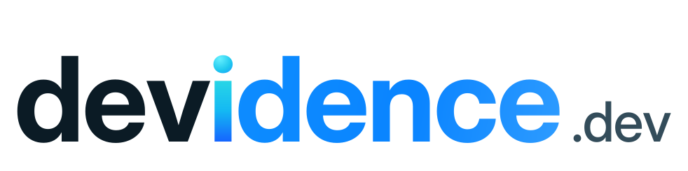

# Devidence Home Landing Page

Landing page for devidence, built with Svelte, Vite and Tailwind CSS v4. Dark-only glass social buttons over an animated starfield.



## 🌟 Features

- Dark-only look: deep navy radial gradient with a cyan accent (tokens in `src/app.css`)
- Animated starfield with shooting stars (`src/lib/Background.svelte`, `src/assets/styles/stars.css`)
- Flat white moon avatar holding the devidence logo (`src/lib/Profile.svelte`)
- Glass social buttons (Medium, GitHub)
- Footer with Terms of Service and Privacy Policy modals
- Fully responsive, honors `prefers-reduced-motion`

## 🛠️ Technologies Used

- [Svelte](https://svelte.dev/) 5 - Framework for building user interfaces
- [Vite](https://vitejs.dev/) 6 - Frontend development tool
- [Tailwind CSS v4](https://tailwindcss.com/) - Utilities, CSS-first config (`@tailwindcss/vite`)
- [Geist](https://vercel.com/font) via `@fontsource-variable/*` - self-hosted fonts
- [Bun](https://bun.sh/) - JavaScript runtime and package manager
- [Caddy](https://caddyserver.com/) - Web server for production
- [Vitest](https://vitest.dev/) with [Testing Library](https://testing-library.com/docs/svelte-testing-library/intro/), [ESLint](https://eslint.org/) and svelte-check - testing and linting
- Docker for production deployment

## 💻 Prerequisites

- [Bun](https://bun.sh/) (the Docker build stage uses `oven/bun:1.4.3-alpine`; the devcontainer uses `oven/bun:1.4.3-slim`)
- [Docker](https://www.docker.com/) and [Docker Compose](https://docs.docker.com/compose/) (for deployment)

## 🚀 Installation and Usage

### Local Development

1. Clone this repository
   ```bash
   git clone https://github.com/devidence-dev/devidence-home.git
   cd devidence-home
   ```

2. Install dependencies
   ```bash
   bun install
   ```

3. Start the development server
   ```bash
   bun run dev
   ```

4. Open your browser at [http://localhost:5173](http://localhost:5173)

### Build for Production

```bash
bun run build
```

The generated files will be in the `dist` directory. Preview them with `bun run preview`.

### Scripts

| Command | Description |
|---|---|
| `bun run dev` | Start the Vite dev server |
| `bun run build` | Production build into `dist/` |
| `bun run preview` | Serve the production build locally |
| `bun run lint` | Run ESLint on `src/` |
| `bun run check` | Run svelte-check |
| `bun run test` | Run the Vitest suite once |
| `bun run test:watch` | Run Vitest in watch mode |

## 🐳 Deployment with Docker

The project includes Docker configuration with security hardening measures.

1. Build and run with Docker Compose. `docker-compose.override.yml` attaches the app to an external network named `cloudflared-net` and publishes port 8080 on `127.0.0.1` only, so create that network first:
   ```bash
   docker network create cloudflared-net
   docker-compose up -d
   ```

2. Access the application at [http://localhost:8080](http://localhost:8080)

### Security Features

- Multi-stage build; the final image is Caddy (Alpine) with only the built files copied in
- Run as a non-privileged user (UID 1000)
- Read-only file system (writable `tmpfs` only for `/tmp`, `/data` and `/config`)
- All Linux capabilities dropped, `no-new-privileges` enabled
- Caddy web server with hardened configuration and security headers (CSP, HSTS, X-Frame-Options, COOP/CORP, Permissions-Policy)
- Hidden files and `.json`, `.md`, `.log`, `.yml` and `.yaml` requests are denied

## 🎨 Customization

1. Texts and links: `src/App.svelte` (profile name and description, social buttons); legal text in `src/lib/TermsContent.svelte` and `src/lib/PrivacyContent.svelte`
2. Colors: the token block in `:root` at the top of `src/app.css` (`--bg`, `--ink`, `--accent`, `--glass`, ...). The site is dark only, so there is a single set of values.
3. Logo and moon: `public/images/devidence-logo-light.svg`, `moon-maria.svg` and `moon-craters.svg`. The moon's base color and shadow are in the `.moon` style in `src/lib/Profile.svelte`.
4. Favicon: replace `public/favicon.svg`. The `favicon.ico`, `favicon-32x32.png` and `apple-touch-icon.png` files are generated from it in the `Dockerfile` build step (ImageMagick and librsvg), so they exist only in the Docker image, not in the local dev server. The build fails if any of them comes out empty.

## 🔒 Security

This project implements multiple layers of security:

- HTTP security headers (CSP, X-Frame-Options, etc.)
- Hardened Docker container
- Run as a non-privileged user
- Principle of least privilege applied

## License 🔒

Pablo Pin - devidence.dev ©

## 🙏 Acknowledgments

- devidence.dev ©
